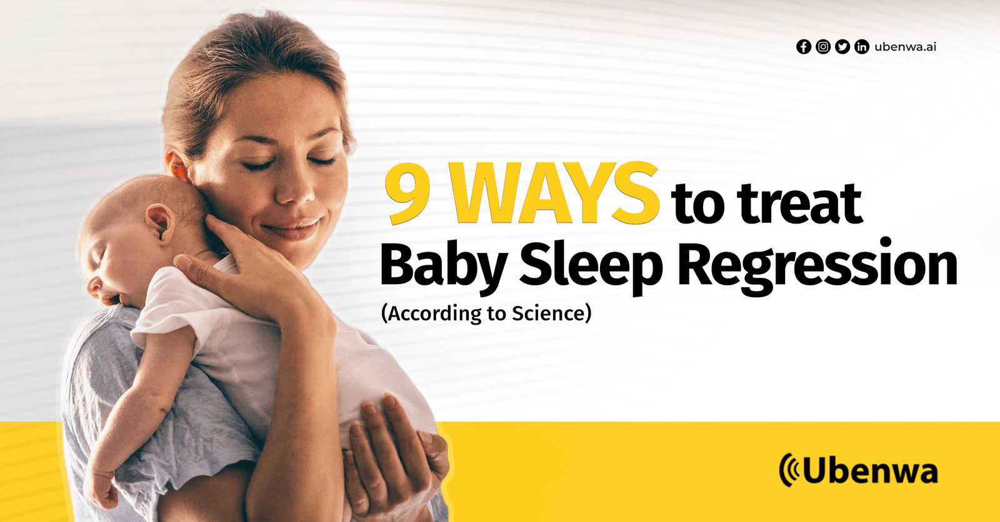

Do you feel like your **little one's sleep schedule has gone haywire?** You're not alone! It's a story that's all too common: after a long and difficult struggle, you finally managed to get a few weeks of blissful sleep through the night. **Then suddenly, it all starts up again** - the fussy bedtime, the nighttime wake ups - where did all your progress go? How long will this last? Worry not - Ubenwa's got you covered. In this article, we'll go over everything scientists currently know about Sleep Regression, and give you **9 ways to treat baby sleep regression (according to science), so you and your little one can finally get the peaceful sleep you deserve**.

## What Is Sleep Regression?

Is there a 6 month sleep regression? A 12 month sleep regression? 15 months? And is this all really backed by science? **Let's set the record straight: sleep regression stages are a total myth1**. That is, they do NOT exist as they're usually described.

Every baby is different, and there is no single month where there is a sudden peak in sleep problems1. So no, there are not exactly 10 stages of sleep regression. And no, sleep regressions do not always follow a schedule. And most important of all: unlike many other sleep coaches suggest, the changes are NOT permanent! Large scale studies have consistently found that babies will wake less over times2. **In fact, the causes of “sleep regression” have little to do with sleep itself.**

These are **exciting times for your baby** - you'd have trouble sleeping too! Of course, sleep disturbances can also be caused by unhealthy external pressures that should be removed or addressed as much as possible. For example:

- Schedule or activity changes (or lack of change when appropriate)
- Inconsistent bedtime routine
- Illness or underlying medical condition

Difficulty sleeping usually happens when your little one reaches exciting developmental milestones, so these “regressions” should actually be celebrated as **significant leaps forward.** For example:

- Learning to walk or crawl
- Growth spurts
- Teething
- Developing Object Permanence

## Could Nighttime Waking Be Harmful To Your Child?

No! Unless your child is being woken by unhealthy external pressures, nighttime wake ups are completely natural and will not harm your little one.

**In fact, the exact opposite is true: although it can be frustrating for parents, being able to wake up easily at night can actually PROTECT your child!** While the cause of Sudden Infant Death Syndrome (SIDS) is not fully known, deep sleep - also known as slow-wave sleep - can be challenging for an infant. When faced with a dangerous situation, a healthy child will rouse while one with undetected risk factors may not.

**This means that prematurely pushing a baby towards longer, deeper sleep, can actually increase the risk of SIDS3**. An example of this is the outdated, dangerous advice of putting babies to sleep on their stomach. This will make them sleep more deeply, but can also increase the risk of SIDS by up to 13 times4 So don't worry if it seems as though your child is 'regressing' - they're just using the tools nature gave them to keep themselves safe!

## Common Causes Of Sleep Regression

Every child is unique, so sleep disturbances can happen at different times (or not at all!) depending on when your child reaches certain milestones.

According to Elisa Basora-Rovira, M.D5, some of the most common are:

### 4 Months Sleep Regression

At this age, babies begin to develop more advanced sleep patterns and the biology of their sleep changes. Your little one is figuring out day and night! Because of this, they may start waking up more often at night or be more easily stimulated by their surroundings.

### 6 Months Sleep Regression

At 6 months your baby will be learning new motor skills and how to babble, so they may just be too excited to sleep! Another common cause of sleep regression at 6 months is teething.

### 9 Months Sleep Regression

At 9 months, separation anxiety might kick in and your baby may not want to go to sleep without you. And as babies begin to become more mobile, they may become more excited and active before bed, making it harder for them to fall asleep.

### 12 Months Sleep Regression

This is when many babies experience a sleep regression your baby transitions from two naps to one. This change in their sleep schedule can be confusing and can lead to disruptions in their nighttime sleep.

### 18 Months Sleep Regression

Similarly, this is when many toddlers begin to experience a sleep regression as they transition from one nap to no naps. Their growing independence and desire to test boundaries can also lead them to ‘rebel' against bedtime.

## How To Solve Sleep Regression

Here are 9 tips to help solve sleep regression!

### 1\. Analyse Their Cry With the Nanni AI app:

If your baby frequently wakes up crying, that's actually a valuable opportunity to learn more about their health! Here at Ubenwa, we've discovered that the sound of your little one's cry can be analyzed like any other vital sign (such as heartbeat or blood pressure) to give unique insights into their health WITHOUT a visit to the doctor's office. If you want to analyze your own baby's cry while also contributing to the health of babies worldwide. Get the Nanni AI app [here](https://ubenwa.ai/nanni.html?utm_source=internal&utm_medium=blog&utm_campaign=9WaysSleepRegression).

### 2\. Stick To A Consistent Bedtime Routine:

Whatever you choose to do, make sure it's consistent. Your kiddo needs to know when it's time to wind down for the night.

### 3\. Create A Calming Sleep Environment

Keep your child's room dark, cool, and quiet to help them sleep better.

### 4\. Try White Noise

White noise can help soothe your child and block out any external distractions.

### 5\. Avoid Stimulating Activities Before Bed

No stimulating activities like toys or watching TV before bedtime. Blue light from screens can also inhibit melatonin production, a hormone that helps regulate sleep.

### 6\. Avoid Napping Too Close To Bedtime

This might make it harder for your little one to fall asleep.

### 7\. Encourage Independence

As your child gets older, encourage them to fall asleep on their own and resist the urge to intervene every time they wake up at night.

### 8\. Be Patient

Remember that sleep regression is a normal part of development. Over time, their sleep patterns will improve.

### 9\. Seek Help If Necessary

Although sleep regressions are normal, if the problems persist or cause significant stress then consider seeking help from a pediatrician or sleep specialist.

## Last Words From Ubenwa

Sleep regression can be stressful for both parents and children, so try to be patient and understanding. Every child is different and what works for one child may not work for another. Changes in sleep patterns are a normal part of a child's development, but don't forget that they're TEMPORARY! And even though you may be frustrated and tired, if your child can be easily roused, be thankful - it may just save their life.

Want to learn more about your baby's health and get access to AI-powered health reports not available anywhere else? **[Click here](https://ubenwa.ai/nanni.html?utm_source=blog&utm_medium=article&utm_campaign=nanniai)** to analyse your baby's cry today with Ubenwa's brand new app (now accepting alpha testers)!

## References

1. Jodi A. Mindell, PhD, quoted in [https://www.bbc.com/future/article/20220131-the-science-of-safe-and-healthy-baby-sleep](https://www.bbc.com/future/article/20220131-the-science-of-safe-and-healthy-baby-sleep) - Dr. Mindell is a clinical psychologist and sleep expert who has written several articles and books on sleep regression in babies, including "Sleeping Through the Night: How Infants, Toddlers, and Their Parents Can Get a Good Night's Sleep" and "Solve Your Child's Sleep Problems: New, Revised, and Expanded Edition."
2. Jodi A. Mindell, PhD, et al. Cross-cultural differences in infant and toddler sleep. [https://pubmed.ncbi.nlm.nih.gov/20138578/](https://pubmed.ncbi.nlm.nih.gov/20138578/)
3. James McKenna, PhD, quoted in [https://www.bbc.com/future/article/20220131-the-science-of-safe-and-healthy-baby-sleep](https://www.bbc.com/future/article/20220131-the-science-of-safe-and-healthy-baby-sleep). - James McKenna is the founder and director of the Mother-Baby Behavioral Sleep Laboratory at the University of Notre Dame and endowed chair in anthropology at Santa Clara University, California.
4. Prof RG Carpenter, PhD, et al. Sudden unexplained infant death in 20 regions in Europe: case control study [https://www.sciencedirect.com/science/article/abs/pii/S0140673603153238](https://www.sciencedirect.com/science/article/abs/pii/S0140673603153238)
5. Elisa Basora-Rovira, M.D., quoted in [https://www.childrens.com/health-wellness/sleep-regression-in-infants-and-toddlers](https://www.childrens.com/health-wellness/sleep-regression-in-infants-and-toddlers) - Elisa Basora-Rovira, M.D. is a pediatric sleep medicine physician at Children's Health and Assistant Professor at UT Southwestern
