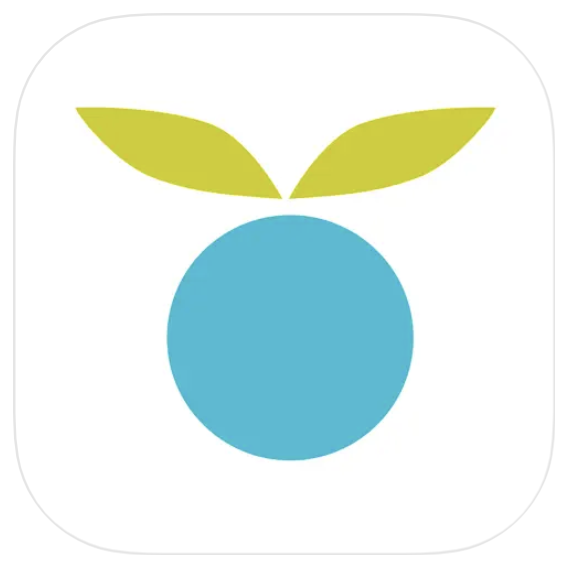
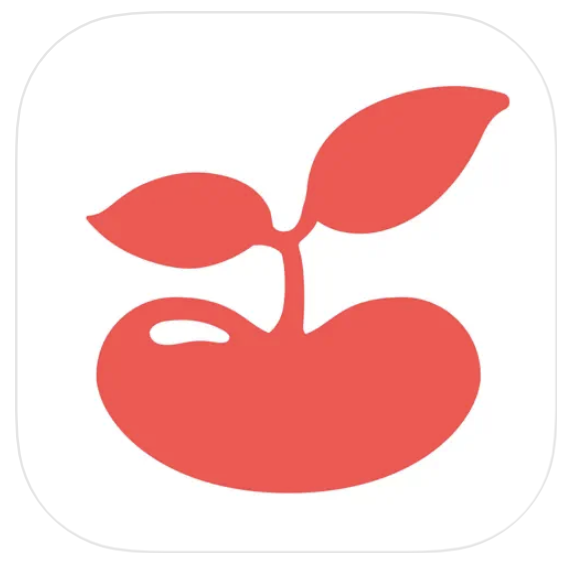

Are you a new dad navigating parenthood? We understand your journey and have curated a list of top apps tailored for dads like you. Whether you're deciphering your baby's cries or seeking guidance on supporting your partner through pregnancy, these apps are essential for every dad. Explore these 5 must-have best apps for new dads today!

## Nanni AI: Your Baby Translator

Experience Nanni AI, the revolutionary app that decodes your baby’s cries with precision. Powered by years of clinical research and cutting-edge AI, it provides insights into why your baby is upset and suggests soothing techniques. Track sleep, diapers, and feeding, practice interpreting your baby’s cries, and get answers to parenting questions with its AI chatbot. This all-in-one tool is your secret weapon to mastering dadhood. Get it today, [here!](https://ubenwa.ai/nanni.html?utm_source=internal&utm_medium=blog&utm_campaign=BestAppsNewDads)

## Daddy Up

Discover "the dad’s field guide to pregnancy" with Daddy Up, a rugged app designed specifically for dads. Stay updated with weekly pregnancy insights featuring rugged baby-size comparisons, a customizable checklist, and tools for sharing baby announcements. It's the ultimate resource wrapped in a lumberjack-themed package, perfect for dads embracing fatherhood. Check it out [here.](https://daddyup.com/)

## HiDaddy - pregnancy for Dads

HiDaddy is a leading free app tailored for dads, functioning as both a pregnancy tracker and a comprehensive dad's field guide. It offers essential tools, a journal feature, and regular updates on the baby's growth and development. The app also includes playful messages from the baby and partner, along with practical tips to navigate this significant phase of fatherhood. For dads looking to stay informed and involved during pregnancy, HiDaddy! is the ideal companion app, offering insights and support every step of the way. Mom might also be interested in the HiMommy app, try them out [here](https://himommy.app/en/pages/about-himommy-pregnancy-app).

## Huckleberry

Huckleberry is renowned for its advanced baby-tracking capabilities, especially its comprehensive sleep monitoring. Track sleep, feeding, diapers, growth, and more with the free version. Upgrade for personalized sleep plans and access to "Sweet Spot," pinpointing the ideal time for your baby to sleep—perfect for tech-savvy dads and moms alike. Read more about it [here](https://huckleberrycare.com/).

## TinyBeans

Share precious moments securely with TinyBeans, a private photo-sharing app. Create a safe, invite-only network for friends and family to follow your baby's journey through life's milestones. Designed for ease of use by parents, TinyBeans keeps loved ones connected to your child's special moments. Find out more about what TinyBeans has to offer [here.](https://tinybeans.com/)
