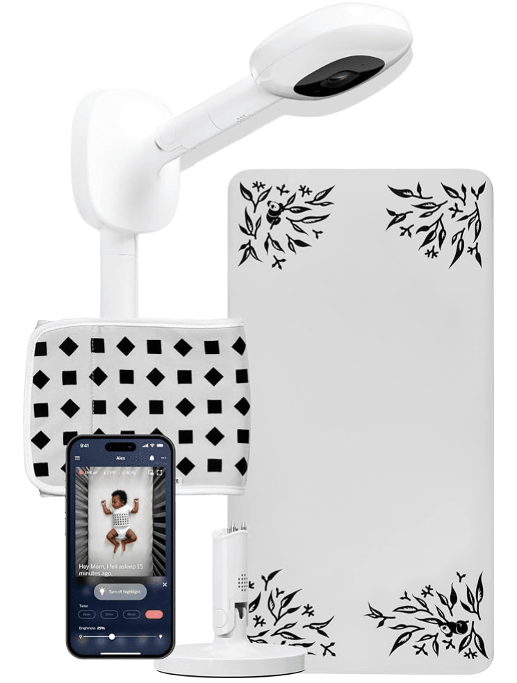
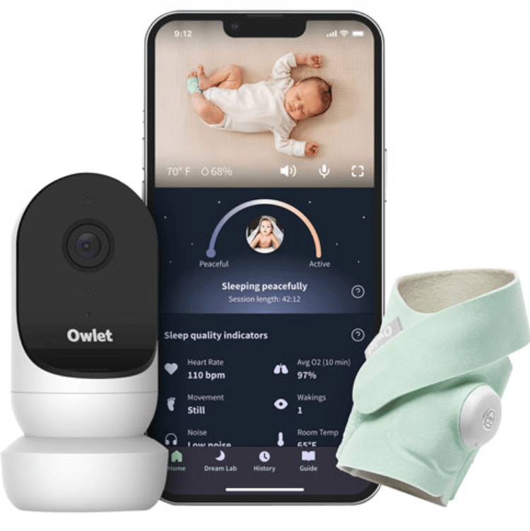
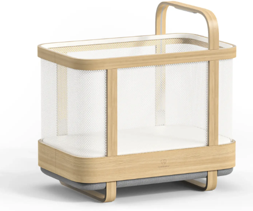

Are you a tech-savvy new parent looking for advanced baby monitoring solutions? We've handpicked a list of the best baby monitor technology for new parents that go beyond traditional baby monitors just for you!

## Nanni AI: Your Baby Translator App

Explore Nanni AI, a top-rated app leveraging advanced tech to interpret your baby's cries accurately. This unique app is powered by years of clinical research and cutting-edge AI. It offers personalized soothing techniques and seamlessly tracks sleep patterns, diaper changes, feeding times, and milestones. Ideal for new parents, Nanni AI simplifies your journey with comprehensive tools, making it a must-have among baby monitors and parenting apps. Don't miss out, try it [here](https://ubenwa.ai/nanni.html?utm_source=internal&utm_medium=blog&utm_campaign=BabyMonitorTech)!

## Nanit Pro (with Breathing Wear and Smart Sheets)

The Nanit Pro provides crystal-clear 1080p views and incorporates innovative Breathing Wear for non-invasive breathing monitoring. Additionally, its Smart Sheets meticulously track your baby’s growth, while the Multi-Stand enhances portability between different rooms. This set makes it a versatile and comprehensive solution for monitoring sleep, breathing, and development. Check out Nanit [here](https://nanit.ca/).

## Owlet - Dream Duo (Sock and Cam)

The Owlet Dream Duo combines the Sock and Cam to monitor your child’s sleep quality, including real-time heart rate and oxygen level monitoring. This is complemented by HD video streaming directly to your smartphone. Its Predictive Sleep Technology goes beyond monitoring to automatically track sleep patterns, offering proactive alerts and insights. To ensure you're always aware of your child's needs, day or night, learn more about Owlet [here](http://www.owletcare.ca).

## Cradlewise Smart Crib

Cradlewise is not just a convertible bassinet and crib with a built-in monitor and AI technology; it's a revolutionary sleep solution that detects your baby’s movements and offers tailored soothing techniques to promote peaceful sleep. It has features like remote monitoring, detailed sleep tracking, and customizable settings. This allows Cradlewise to ensure an optimal sleep environment from infancy through toddlerhood, providing peace of mind for parents at every stage. Find out about Cradlewise's Smart Crib [here](https://cradlewise.com/).
