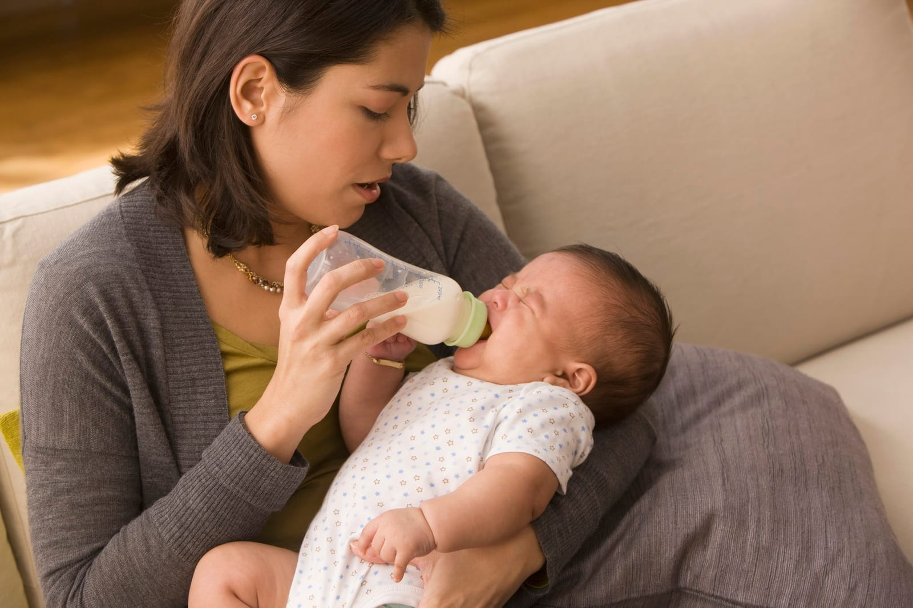
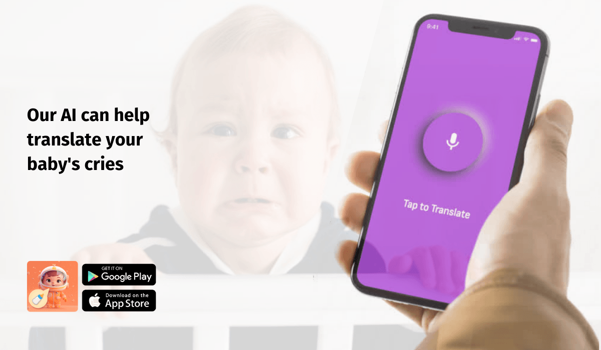

## The Myths (and Reality) of Baby Pain

Once upon a time, scientists actually believed that **newborns couldn't feel pain**. Imagine that! Thankfully, with the advancement of science **we've come to understand that babies, just like us, can indeed feel pain.** And here's the exciting part: with the magic of technology, we're now in a better position to understand our babies' needs like never before.

Our AI powered app - [**Nanni AI**](https://ubenwa.ai/nanni.html?utm_source=blog&utm_medium=article&utm_campaign=nanniai) that can help parents identify why their baby is crying and identify pain cries.

As we pointed out in our latest [**press release**](https://www.newswire.ca/news-releases/about-45-of-baby-cries-are-due-to-pain-according-to-breakthrough-ai-baby-cry-translator-828122000.html), significant number of cries recorded by our app, and validated by the caregiver, point towards pain, which tells us that **pain is a major cause of crying** in newborns.

So let's embark on a journey to understand the language of baby cries and learn how to recognize when our precious ones are in distress.

## 1\. Recognizing the Sign

Ever wondered why your baby is crying? Here are some signs they might be in pain:

 - **Crying**: Your baby cries for many reasons, including pain. For help translating, use [Nanni AI](https://ubenwa.ai/nanni.html?utm_source=blog&utm_medium=article&utm_campaign=nanniai) to analyze the cry with AI.
 - **Sounds**: Apart from crying, they might whimper.
 - **Facial** clue: Grimacing or a furrowed brow.
 - **Body Language**: Arching their back or flinching.
 - **Routine Changes:** They might sleep or eat differently.

## 2\. The Silent Signals: How else do Babies Show They’re in Pain?

Babies can't tell us they're hurting, but their bodies give us clues.

 - **Heartbeat and Breathing Patterns**: A sudden spike in heart rate or rapid, shallow breathing can be a telltale sign.
 - **Blood Pressure**: Just like in adults, it rises when they're in distress.
 - **Oxygen Levels**: If these drop, it's a red flag.
 - **Stress Signs**: Release of stress hormones like cortisol.

If these signs persist, it's essential to address them quickly to protect your baby's health.

## 3\. The Ripple Effect: Why Addressing Baby pain Early Matters

Like most health issues, early detection is the key. Pain in infants can cause much more damage if left untreated.

 - **Brain Development**: Pain can interfere with the formation of brain connections, known as neural pathways. This interference can heighten their sensitivity to stress as they mature.

 - **Behavioral Changes**: A baby in pain might struggle with sleep, show reduced appetite, or appear more irritable. Over time, these disruptions can influence their cognitive and behavioral growth.

## 4\. Developmental Effects: The Long-Term Consequences of Pain

 - **Heightened Pain Sensitivity**: Babies who frequently endure pain without relief might develop a heightened sensitivity to pain as they age.
 - **Mental Health Implications**: Early painful experiences have been associated with groundwork for anxiety, depression, and other mental health challenges in their later years.
 - **Immune System Effects**: When babies often feel pain and don't get comfort, it can upset their stress balance and natural defense system. This might change how well they fight off sickness in the future.

## 5\. Tools to Help Understand Baby Pain

Doctors and nurses use tools like the Neonatal Pain, Agitation, and Sedation Scale (N-PASS) and the Premature Infant Pain Profile (PIPP) to understand baby pain. These tools look at both the physical and behavioral signs to get a full picture.

At home, you can use **[Nanni AI.](https://ubenwa.ai/nanni.html?utm_source=blog&utm_medium=article&utm_campaign=nanniai)** This mobile app is a handy tool to assist you figure out if your baby's cry is due to pain, discomfort, hunger or tired.

## Wrap-Up: Importance of Recognizing Baby Pain

Understanding and managing baby pain isn't just about keeping them comfortable - it's about giving them the best start in life.

Every baby deserves to grow up without unnecessary pain. With the tools and knowledge we have today, including innovative apps, we're better equipped than ever to care for our little ones.

**Note:** *Remember, your baby is your responsibility, and you know your baby best. **Always trust your judgment first** and **consult with a healthcare professional** if you have any concerns about your baby’s health. The model accuracy can vary, in particular in noisy environments.*

**Connect with us on Social Media**

## References

 - Prevention and Management of Pain in the Neonate: An Update. American Academy of Pediatrics, Canadian Paediatric Society [https://publications.aap.org/pediatrics/article/118/5/2231/69964/Prevention-and-Management-of-Pain-in-the-Neonate](https://publications.aap.org/pediatrics/article/118/5/2231/69964/Prevention-and-Management-of-Pain-in-the-Neonate)

 - Pain Management in Newborns. Hall, R. W., & Anand, K. J. S.
[Pain management in newborns - PubMed (nih.gov)](https://pubmed.ncbi.nlm.nih.gov/25459780/)

 - Pain in Infants (Babies). Children's Minnesota
[https://www.childrensmn.org/educationmaterials/childrensmn/article/15329/pain-in-infants-babies/](https://www.childrensmn.org/educationmaterials/childrensmn/article/15329/pain-in-infants-babies/)

 - Long-term consequences of pain in human neonates. Ruth E. Grunau, Liisa Holsti, Jeroen W.B. Peters
[https://www.sfnmjournal.com/article/S1744-165X(06)00026-6/fulltext](https://www.sfnmjournal.com/article/S1744-165X\(06\)00026-6/fulltext)

 - Neonatal Pain in Very Preterm Infants: Long-Term Effects on Brain, Neurodevelopment and Pain Reactivity. Ruth E. Grunau
[https://www.ncbi.nlm.nih.gov/pmc/articles/PMC3820298/pdf/rmmj-4-4-e0025.pdf](https://www.ncbi.nlm.nih.gov/pmc/articles/PMC3820298/pdf/rmmj-4-4-e0025.pdf)

 - Biological and Neurodevelopmental Implications of Neonatal Pain. Suellen M. Walker
[https://www.sciencedirect.com/science/article/abs/pii/S0095510813000572?via%3Dihub](https://www.sciencedirect.com/science/article/abs/pii/S0095510813000572?via%3Dihub)

 - Exposure to Early Life Pain: Long Term Consequences and Contributing Mechanisms. Nicole C. Victoria and Anne Z.Murphy
[https://www.ncbi.nlm.nih.gov/pmc/articles/PMC4979223/](https://www.ncbi.nlm.nih.gov/pmc/articles/PMC4979223/)

 - Guidelines on Neonatal Pain Assessment and Management. WHO
[https://platform.who.int/docs/default-source/mca-documents/policy-documents/guideline/ARE-MN-62-09-GUIDELINE-2017-eng-Neonatal-Pain-Management.pdf](https://platform.who.int/docs/default-source/mca-documents/policy-documents/guideline/ARE-MN-62-09-GUIDELINE-2017-eng-Neonatal-Pain-Management.pdf)ol [icy-documents/guideline/ARE-MN-62-09-GUIDELINE-2017-eng-Neo natal-Pain-Management.pdf](https://platform.who.int/docs/default-source/mca-documents/policy-documents/guideline/ARE-MN-62-09-GUIDELINE-2017-eng-Neonatal-Pain-Management.pdf)

 - Assessing pain in babies; SickKidsStaff
[https://www.aboutkidshealth.ca/article?contentid=477&language=english](https://www.aboutkidshealth.ca/article?contentid=477&language=english)
