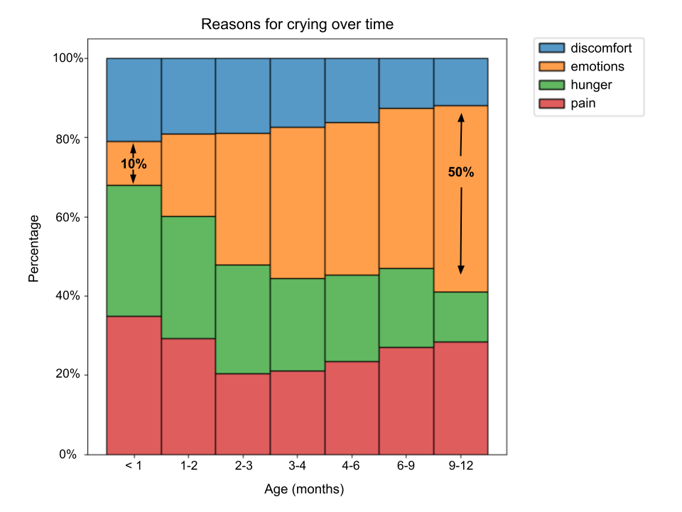
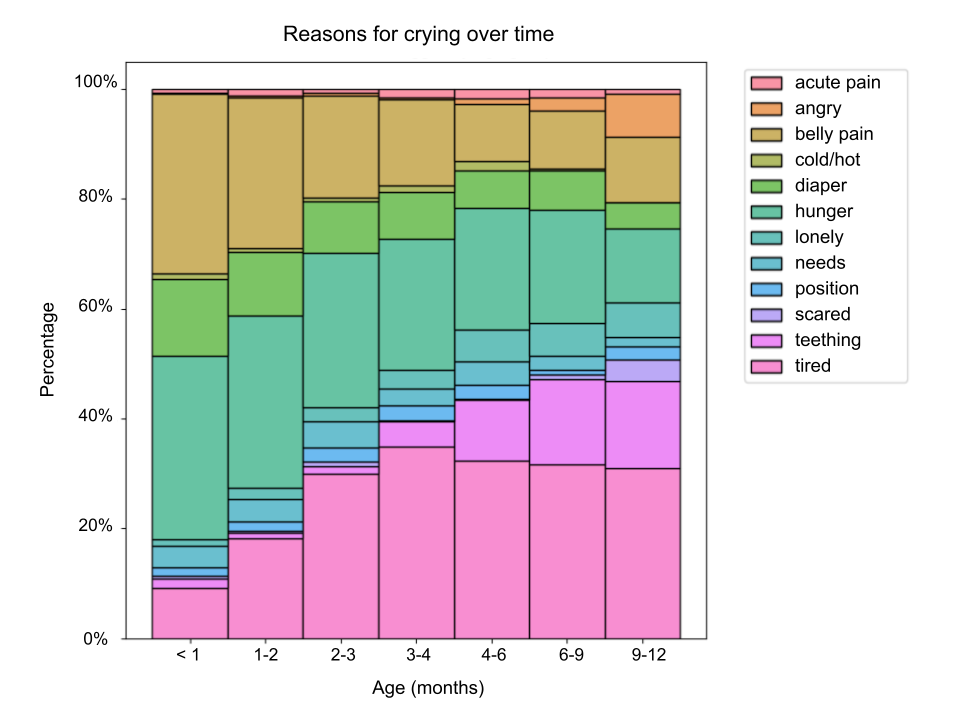

From the instant they arrive in this world, babies appear to possess their own unique language – their **cry sound**. As a parent, interpreting their cries and comforting them becomes your top priority, *and ours too.* From hunger to crying for attention, your baby’s cries evolve over time. Just as you begin to feel confident in your abilities, your little one progresses into the next phase of development. This introduces a fresh set of demands and challenges.

Just as you begin to feel confident in your abilities, your little one progresses into the next phase of development, introducing a fresh set of demands and challenges.

Through **analyzing hundreds of thousands of cries** received from Ubenwa’s clinical studies as well as from parents using our tool Nanni AI, we've identified **how these needs behind their tears change over time**. We hope this insight will help you be better prepared for your little one’s development.

## What Changes?

Initially, we looked at four basic needs: **hunger, pain, discomfort** (diaper, position, etc) **and emotions** (tiredness, fear and other). The evolution of these needs with age is shown below.

While these categories are quite broad, we can still make a few observations. In the early days of life, the major reasons for crying for newborns appear to be pain and hunger.

It may seem scary at first glance, however, the pain category covers everything from a belly ache to physical trauma. So it's not surprising that that they're in pain as their bodies are learning how to digest food and tend to get more gas than adults.

As babies develop, we note a **clear increase in stress/emotions as the main culprit for shedding tears.** This aligns with the baby’s maturation and brain development: a newborn primarily cries when they are aroused due to internal/external triggers (e.g. hunger, temperature change)<a href="https://www.aboutkidshealth.ca/Article?contentid=448&amp;language=English">1</a>.

As they grow, not only do parents become masters at managing their feed cycle, but babies learn to express their emotions. They learn **how to elicit attention more effectively** from their caregivers through their cry<a href="https://www.nct.org.uk/baby-toddler/crying/why-do-babies-cry-reasons-and-responses#:~:text=I%20need%20attention&amp;text=Over%20time%2C%20older%20babies%20may,through%20to%20tips%20on%20soothing.">2</a>.

## A Closer Look

A more detailed breakdown of feedback from the parents sheds light on more specific causes of crying and is shown below.

As we can see, **the amount of belly pain reported by our users decreased** by half by the age of 3-4 months. However, **painful cries soon come back** with pain caused by growing teeth after 4 months old.

Also, we observe **more emotions like “loneliness” and “anger” as your baby grows.**

While some of these facts about a baby’s development are expected and perhaps known, Nanni AI is able to discern these changes through ***just the baby’s cry***. Be sure to try out the Nanni AI cry translator today!

Babies are communicating about their growth way before they can speak. These insights can ultimately help new parents understand their babies better and be less surprised at certain stages of growth.

## References

1. [https://www.aboutkidshealth.ca/Article?contentid=448&language=English](https://www.aboutkidshealth.ca/Article?contentid=448&language=English)
2. [https://www.nct.org.uk/baby-toddler/crying/why-do-babies-cry-reasons-and-responses#:~:text=I%20need%20attention&text=Over%20time%2C%20older%20babies%20may,through%20to%20tips%20on%20soothing.](https://www.nct.org.uk/baby-toddler/crying/why-do-babies-cry-reasons-and-responses#:~:text=I%20need%20attention&text=Over%20time%2C%20older%20babies%20may,through%20to%20tips%20on%20soothing.)
