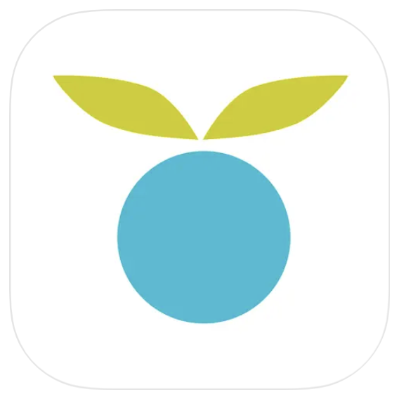
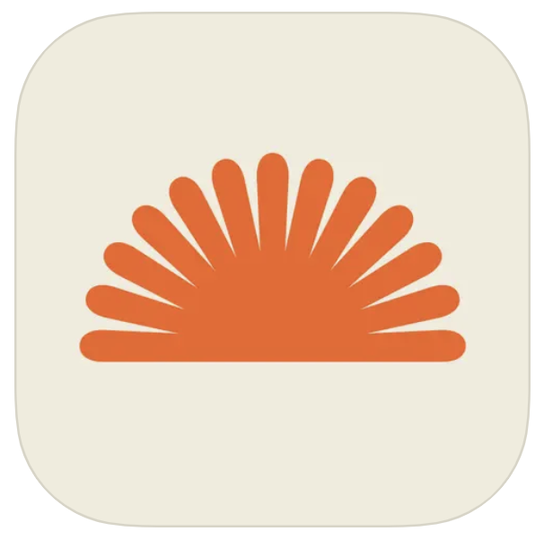
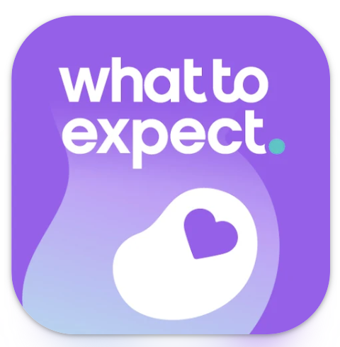
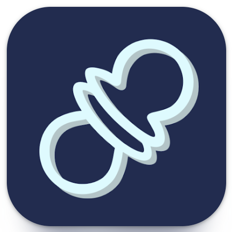

You’ve heard that you should track your baby’s routines, keeping a log of sleep, feeds, diapers, and developmental milestones. But with so many options out there for routine tracking, how can you choose? Look no further. We’ve curated a list of the 5 best baby tracker apps around so you can make your selection from the top apps!

## Nanni AI: Your Baby Translator

This sophisticated, AI-powered app not only interprets your baby's cries with precision, but also provides comprehensive tracking tools to manage your baby’s daily routine effectively. Nanni AI allows you to monitor crucial aspects of your baby’s care, including sleep patterns (sleep and wake times), feeding schedule (times, amounts, and breast or bottle), diaper changes (frequency and pee/poop details), and key developmental milestones to monitor your baby’s progress and celebrate achievements. With Nanni AI, all this data is seamlessly integrated and easily accessible, helping you gain a clearer understanding of your baby’s overall well-being. The app’s advanced tracking capabilities provide a holistic view of your baby’s needs, making it an indispensable tool for new parents to optimize their child's daily care and development. Bonus, with Premium you can share information with another caregiver so you both can track from your own devices. Don't delay, try it out [here!](https://ubenwa.ai/nanni.html?utm_source=internal&utm_medium=blog&utm_campaign=BestBabyTrackers)

## Huckleberry: Baby & Child

Huckleberry stands out for its robust baby-tracking features, especially in the areas of sleep and activity monitoring. This comprehensive baby tracker allows you to track crucial aspects of your baby’s daily routine, including sleep patterns, feeding schedules, growth metrics, and more. By providing detailed insights, Huckleberry helps you fine-tune your baby’s schedule for better management. With the premium upgrade, Huckleberry offers personalized sleep plans and expert guidance to discover your baby’s ideal sleep "Sweet Spot." This makes Huckleberry an essential tool for new parents aiming to enhance their child’s sleep quality and overall well-being. Find out more about it [here](https://huckleberrycare.com/).

## Baby Tracker by Nara

The Nara app is your go-to solution for comprehensive baby tracking. It allows you to effortlessly monitor essential aspects of your baby's daily routine, including breastfeeding and bottle feeding, diaper changes, sleep patterns and naps, growth milestones, and postpartum recovery. Additionally, the app offers customizable routines to suit your family’s unique needs. One standout feature of the Nara app is its ability to coordinate with other caregivers. Whether your baby is at daycare, with another parent, or staying with a grandparent, you can easily share and update important care information. This seamless communication helps ensure consistent and informed care, making the Nara app an indispensable tool for managing your baby’s needs. Read all about it [here](https://narababy.com/pages/nara-baby-tracker).

## Pregnancy & Baby Tracker - What to Expect

The What to Expect app is a comprehensive tool designed for tracking throughout pregnancy and into your baby's early years. This all-in-one baby tracker enables you to monitor a wide range of activities, including breastfeeding, bottle feeding, solid food feeds, diaper changes, sleep patterns, pumping sessions, and tummy time. Additionally, the app allows you to create custom tracking categories for any other aspects you deem important. Renowned for its trusted guidance during pregnancy and early parenting, the What to Expect app continues this tradition by offering access to vibrant parenting communities and an extensive library of blogs. These resources provide valuable tips and tricks to support all your parenting needs, making the What to Expect app an essential companion for managing and optimizing your baby's routine. Explore everything What to Expect has to offer [here](https://www.whattoexpect.com/mobile-app/).

## Napper: Baby Sleep Tracker

Using an all-in-one baby tracker can sometimes be overwhelming, but Napper makes it easy by focusing primarily on your baby's sleep. While Napper still includes essential features like feeding and diaper change tracking, its main strength is in managing and optimizing nap times. The app provides personalized sleep schedules and valuable insights into infant sleep patterns, helping you fine-tune your baby’s rest routine. Napper presents your data through intuitive, easy-to-read graphs, making it simple to track and understand your baby’s sleep trends. Additionally, Napper offers a selection of soothing sleep sounds, including white noise, lullabies, and nature sounds, to help your baby drift off to sleep more easily. With Napper, you can streamline sleep tracking and enhance your baby’s naptime experience. Discover the Napper app [here](https://napper.app/en/).
