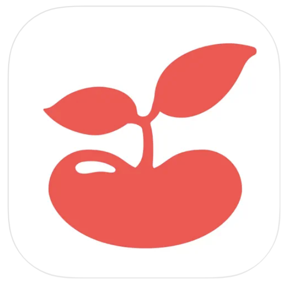
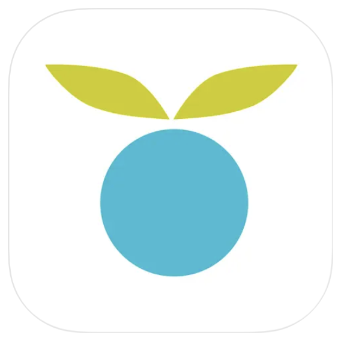

Discover the top 5 apps for parents in 2024, handpicked for their innovation and utility for moms and dads.

## Nanni AI: Your Baby Translator

When you're up late with a crying baby and unsure why, Nanni AI steps in as your essential companion. This cutting-edge app interprets your baby's cries with precision, offering insights and soothing suggestions based on advanced AI and clinical research. Track sleep, diapers, feeding, and developmental milestones with ease. Nanni AI is your comprehensive solution for navigating parenthood. You won't want to delay getting this one, try it out [here!](https://ubenwa.ai/nanni.html?utm_source=internal&utm_medium=blog&utm_campaign=AppsForParents2024)

## Wonder Weeks

The Wonder Weeks app provides invaluable insights into your baby’s mental growth during developmental leaps. It monitors milestones and explains periods of fussiness or clinginess, personalized to your baby’s developmental stage and birth date. Gain clarity on your baby's behavior and nurture their development with this insightful app. Learn more about the Wonder Weeks [here](https://thewonderweeks.com/).

## Peanut

Designed to connect new parents and foster community, Peanut spans from fertility and pregnancy to parenthood and beyond. Join groups, share stories, and seek advice in a supportive environment. Engage in live audio discussions hosted by experts and find camaraderie with others in similar life stages. Check it out [here](https://www.peanut-app.io/).

## TinyBeans

Share your baby’s journey safely with TinyBeans, creating a private network for loved ones to follow and engage with precious moments. This user-friendly app ensures family connection through a secure, invite-only photo album, capturing and celebrating every milestone in your child's early years. Find out more about what TinyBeans has to offer [here.](https://tinybeans.com/)

## Huckleberry

Renowned for its comprehensive baby-tracking capabilities, Huckleberry excels in sleep monitoring and activity tracking. The app logs sleep patterns, feeding schedules, growth metrics, and more, offering detailed insights to optimize your baby's routine. Upgrade for personalized sleep plans and guidance on the ideal sleep "Sweet Spot," making Huckleberry indispensable for new parents seeking to enhance their child's sleep quality. Read more about it [here](https://huckleberrycare.com/).
