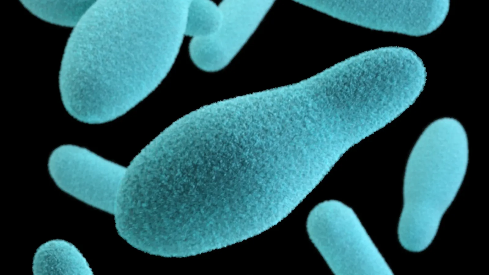

As a new parent, you may have heard that you shouldn’t give honey to your baby, and wondered why honey is off-limits. Understanding the reasons behind this advice is crucial for your baby's health and safety.
<!-- app-cta -->
## The Risk of Infant Botulism

The main reason honey should not be given to infants is the risk of infant botulism. Infant botulism is a rare but serious illness caused by the bacterium *Clostridium botulinum*, which can be found in honey. The spores of this bacterium can grow and produce toxins in a baby’s intestines. This can lead to symptoms such as constipation, weak crying, poor feeding, and muscle weakness. According to the Centers for Disease Control and Prevention ([CDC](https://www.cdc.gov/botulism/hcp/clinical-overview/infant-botulism.html)), infant botulism requires immediate medical attention and can require prolonged hospital treatment.

<figure><figcaption>Botulism bacteria.</figcaption></figure>

## Immature Digestive System of Infants

Infants have an immature digestive system and immune response, which makes them more vulnerable to infections and toxins. Unlike older children and adults, babies cannot efficiently handle the spores of *Clostridium botulinum* that may be present in honey. As their digestive and immune systems mature, the risk decreases. This is why experts recommend waiting until after the first year to introduce honey into your baby's diet.

The American Academy of Pediatrics ([AAP](https://publications.aap.org/aapnews/news/13225/Remind-families-honey-can-cause-infant-botulism)) strongly advises against feeding honey to babies under one year old to avoid the potential for botulism. Following this guideline, you shouldn't give honey to your baby to help ensure your baby's health and safety.
